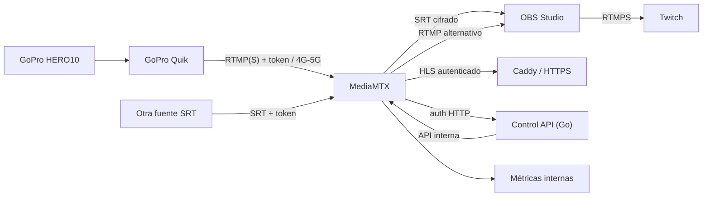
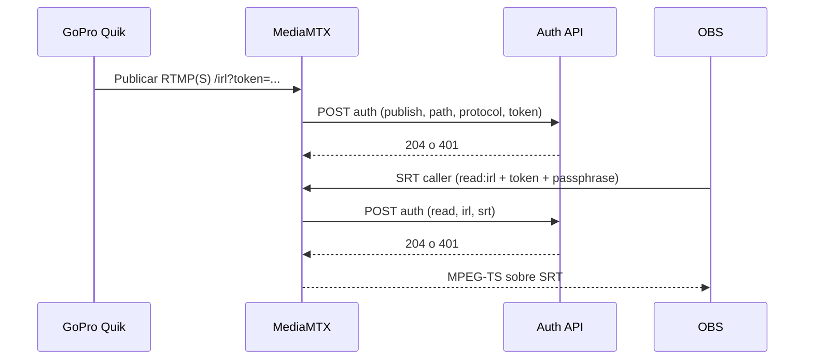
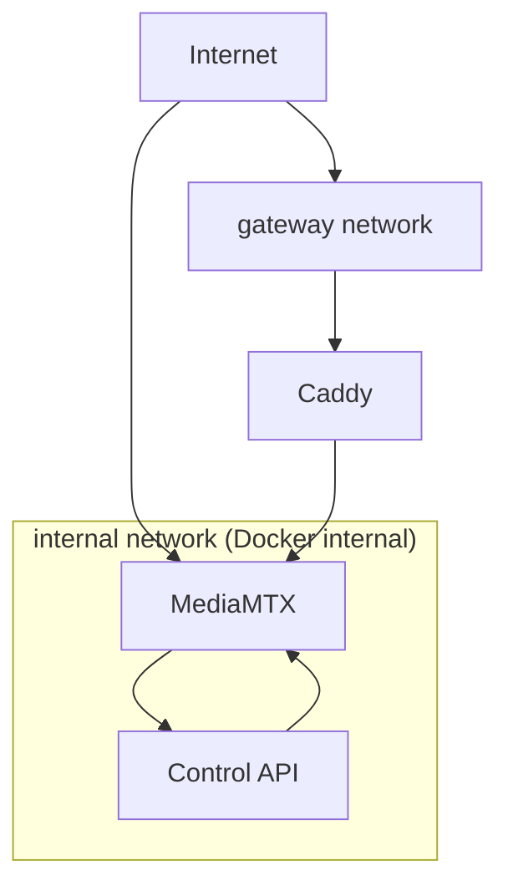

# Arquitectura

## Alcance de la versión 0.1.1

Una sola máquina Linux recibe una única fuente, `MEDIA_PATH` (`irl` por
defecto). El plano multimedia y el
plano de control están separados lógicamente, pero se despliegan juntos. El
sistema enruta H.264/AAC sin transcodificar; esto reduce CPU y evita añadir
latencia. El fallback y la salida persistente se reservan para Fase 2.

## Componentes

| Componente | Responsabilidad | No hace |
|---|---|---|
| MediaMTX 1.19.3 | Ingesta, demultiplexado y conversión de protocolo | Login web, fallback de Fase 2 |
| Control API Go | Autenticación, health/readiness y estado interno | Transcodificar o almacenar secretos |
| Caddy 2.11.4 | HTTPS automático y proxy HLS/salud | Terminar SRT |
| FFmpeg de pruebas | Generar y verificar medios sintéticos | Ejecutarse permanentemente |

## Flujo multimedia

GoPro combina servidor y stream key en una única URL. El token va en query; la
API solo autoriza el `MEDIA_PATH` configurado y no registra query, password ni
token. MediaMTX usa un patrón catch-all porque sus claves YAML no interpolan
variables, pero la autenticación impide publicar o leer cualquier otra ruta.

## Red y puertos

| Puerto | Transporte | Exposición | Uso |
|---|---|---|---|
| 80 | TCP | Público | ACME y redirección HTTPS |
| 443 | TCP/UDP | Público | HTTPS/HTTP3 de Caddy |
| 1935 | TCP | Restringir si se usa | Entrada/salida RTMP sin TLS |
| 1936 | TCP | Público al activar | Entrada RTMPS nativa |
| 8890 | UDP | Público | SRT |
| 8080 | TCP | Solo `127.0.0.1` | Salud/estado operativo |
| 8888 | TCP | Solo red Docker | HLS interno |
| 9997 | TCP | Solo red Docker | API MediaMTX |
| 9998 | TCP | Solo red Docker | Métricas MediaMTX |

RTSP, WebRTC, pprof, playback y MoQ están desactivados.

## Contenedores y confianza

- Solo Caddy y los listeners multimedia necesarios publican puertos.
- La API administrativa y las métricas no tienen binding al host.
- Los procesos persistentes usan usuario no root, filesystem de solo lectura, `tmpfs`,
  `no-new-privileges`, límites de CPU/memoria y rotación de logs.
- `gateway-permissions` es un proceso efímero, sin red y con capacidades
  mínimas, que ajusta los volúmenes antes de iniciar Caddy como UID 10003.
- Los tokens llegan por entorno; no se escriben en configuración ni respuestas.

## Estados operativos

El modelo completo se define ahora aunque Fase 1 solo produce un subconjunto.

| Estado | Significado | Implementado |
|---|---|---|
| `OFFLINE` | Servicios detenidos | Sí, observable externamente |
| `WAITING_FOR_SOURCE` | Nodo listo sin publisher | Sí |
| `CONNECTING` | Handshake en progreso | Parcial, logs de MediaMTX |
| `LIVE` | Fuente real disponible | Sí |
| `DEGRADED` | Señal existe con condición adversa real | Fase 2/4 |
| `RECONNECTING` | Supervisor reintenta | Fase 2 |
| `FALLBACK` | Salida de continuidad activa | Fase 2 |
| `STOPPING` | Parada ordenada | Fase 2 |
| `ERROR` | Fallo que impide operar | Sí, health/readiness |
| `MAINTENANCE` | Operaciones bloqueadas | Fase 3 |

No se infiere `DEGRADED` a partir de valores inventados.

## Métricas y verdad del dato

En Fase 1 MediaMTX expone contadores reales: bytes, conexiones, lectores,
errores de frames y estado de paths. El bitrate se calculará como derivada de
bytes por intervalo en Fase 3/4. Resolución, FPS y códecs se obtendrán de la API
de tracks o `ffprobe`. CPU/RAM/disco procederán del host/contenedores.

La pérdida y jitter de RTSP no se extrapolan a RTMP. Para SRT solo se mostrarán
estadísticas que exponga realmente la conexión. Si no existe fuente, el valor
será `No disponible`, no cero.

## Continuidad prevista (Fase 2)

MediaMTX 1.19.3 incluye `alwaysAvailable`, pero no se adopta ciegamente. Se
evaluará con un clip H.264/AAC cuyos parámetros coincidan con la GoPro. Un
orquestador mantendrá un único worker, aplicará tolerancia a microcortes,
seleccionará live/fallback, persistirá intención y supervisará FFmpeg. La salida
estable será un path separado, por ejemplo `program`, para no acoplar OBS al
publisher.

## Escalabilidad futura

Las fronteras ya permiten mover MediaMTX, API, métricas y almacenamiento a
hosts distintos mediante URLs internas. No se implementan descubrimiento,
balanceo ni multiusuario. Para ello harán falta identidad central, propiedad de
paths, almacenamiento de configuración, cuotas, selección regional y
aislamiento de secretos; no es necesario modificar el protocolo de la fuente.
