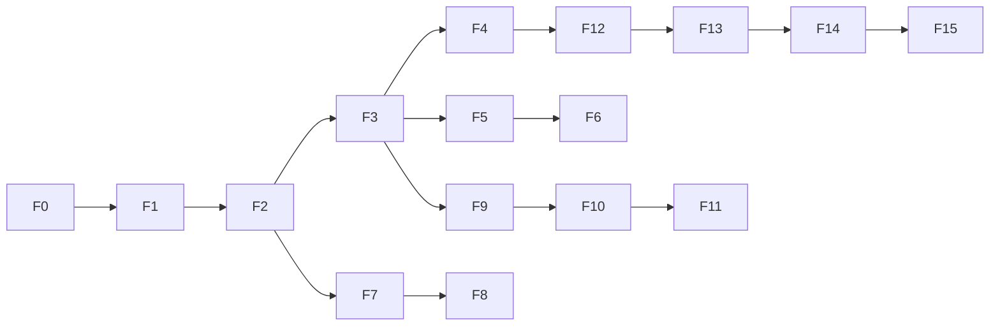

# Roadmap y criterios de aceptación

Cada fase requiere código, documentación y evidencia de pruebas. “Implementado”
no significa “validado en hardware”.

## Fase 0 — Diseño (cerrada)

- Arquitectura, flujos, puertos, estados, métricas y límites definidos.
- Modelo de amenazas y riesgos residuales.
- ADR de media server, autenticación, despliegue y TLS.
- Plan de pruebas sintéticas y físicas.

Aceptación: todos los entregables existen y describen el sistema real.

## Fase 1 — Nodo mínimo (implementada; validación pendiente)

- RTMP/RTMPS y SRT de entrada; SRT/RTMP/HLS de lectura.
- Tokens seguros separados, passphrase SRT, rechazo de claves inválidas.
- Compose, healthchecks, logs JSON y límites.
- Prueba sintética RTMP → SRT con audio y vídeo.

Aceptación final pendiente: prueba en Compose, luego GoPro real y OBS sin
cambiar código.

## Fase 2 — Continuidad

Crear path estable `program`, tolerancia configurable, fallback compatible,
supervisor de proceso, bloqueo de workers duplicados, backoff y recuperación de
reinicios.

Aceptación: OBS conserva una fuente utilizable en cortes de 2 s, 10 s y 60 s y
recupera la imagen real automáticamente.

## Fase 3 — API y panel

Administrador único, Argon2id, cookies seguras, CSRF, sesiones revocables,
estado real por SSE, control permitido, preview y PWA responsive.

Aceptación: ninguna acción es ficticia; una métrica ausente se marca como tal.

## Fase 4 — Observabilidad y alertas

Prometheus, incidentes, correlación, disco/host y un webhook real.

Aceptación: alertas verificadas para pérdida, fallback, regreso, reinicios,
disco y error crítico.

## Fases 5-6 — OBS y agente local

Agente Tauri a evaluar, canal saliente autenticado y OBS WebSocket solo local.

Aceptación: preparar/finalizar directo y cambiar escenas sin exponer el puerto
4455 a Internet.

## Fases 7-10 — Producto streamer

Grabación con retención, multistream aislado, control móvil y overlays con
tokens revocables.

## Fases 11-14 — Operación avanzada

Motor de reglas con allowlist, backups/versionado, auditoría y pruebas de
resistencia documentadas en `docs/TEST_REPORT.md`.

## Fase 15 — Multiusuario/multinodo

Solo después de estabilidad personal. Diseñar identidad, cuotas, aislamiento,
regiones y alta disponibilidad; no implementar pagos ahora.

## Dependencias entre fases

